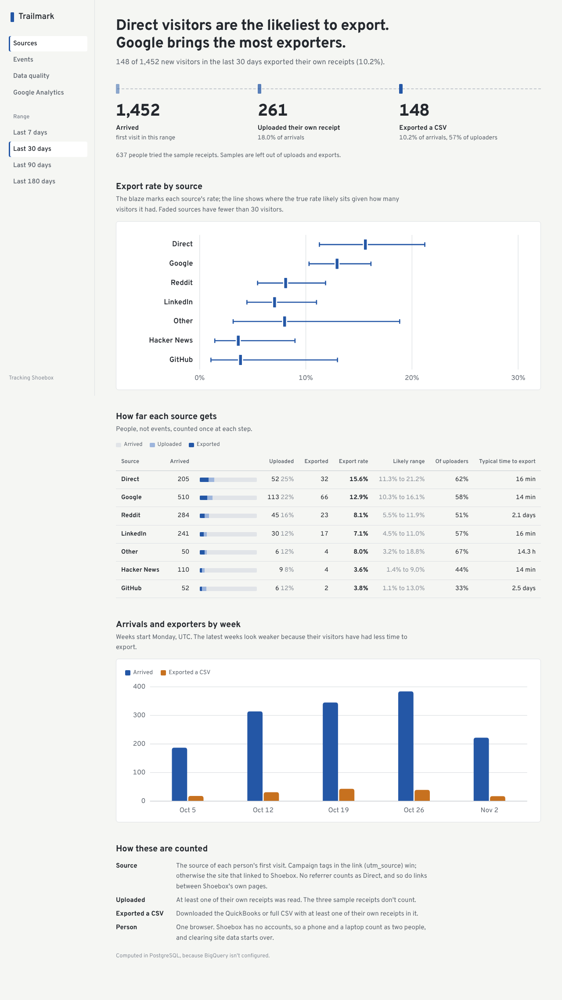

# Trailmark

I built Trailmark to answer one question about [Shoebox](https://github.com/Srigana/shoebox): which places send people who actually use it?

By "use it" I mean they uploaded one of their own receipts and downloaded a CSV. Plenty of people land on Shoebox, try the three sample receipts and leave, so visits alone don't tell me much.



_The screenshot uses the fake data from `npm run seed`, not real Shoebox traffic._

## What's in here

- `server/`: Node and Express. Receives events from Shoebox, checks them, stores them in Postgres and serves the dashboard.
- `client/`: the React dashboard.
- `bigquery/`: the analysis queries for BigQuery. `server/sql/` has the same queries for Postgres, which is what runs locally.

The tracker itself lives in the Shoebox repo (`web/lib/track.ts`). It sends four events: `visit`, `upload`, `upload_failed` and `export`.

## Running it locally

You need Node 20+ and Postgres.

```bash
psql -U postgres -c "CREATE USER analytics WITH PASSWORD 'analytics'" \
  -c "CREATE DATABASE analytics OWNER analytics"

npm install
cp server/.env.example server/.env
npm run seed    # optional: 60 days of fake traffic to look at
npm run dev
```

The dashboard is at http://localhost:5173.

To see real events, run Shoebox next to it with tracking turned on:

```bash
# in shoebox/web
COLLECTOR_URL=http://localhost:4000 NEXT_PUBLIC_COLLECTOR_WRITE_KEY=dev_write_key npm run dev

# in shoebox/api (demo mode returns canned receipts, no Anthropic key needed)
DEMO_MODE=1 .venv/bin/python -m uvicorn app.main:app --port 8000
```

## How things are counted

- A person's source is wherever their first visit came from: `utm_source` if the link had one, otherwise the site that linked to Shoebox. No referrer counts as Direct.
- Sample receipts don't count as uploads, and an export only counts if it had at least one real receipt in it.
- Each rate comes with a 95% range, and sources with fewer than 30 visitors are greyed out. Small numbers swing a lot, and I didn't want 2 out of 5 to look like a winner.
- One browser is one person. Shoebox has no accounts.

## BigQuery

If `BIGQUERY_PROJECT_ID` is set, `npm run sync:bigquery -- --watch` copies new events to BigQuery every minute and the dashboard runs its queries there. Without it, everything runs on Postgres. When someone uses "Delete my data" on Shoebox, the delete gets applied in BigQuery too.

## Google Analytics

There's an optional page that puts GA4's numbers next to Trailmark's. Set `GA_PROPERTY_ID` and give a service account read access to the property. The page also lists the usual reasons the two never match exactly (ad blockers, cookie consent, time zones and so on).

## Tests

```bash
psql -U postgres -c "CREATE DATABASE analytics_test OWNER analytics"
npm test
```

The test database gets wiped on every run, so don't point it at anything you care about.

## Deploying

There's a `render.yaml` for Render. I haven't deployed it yet. If you do, set `WRITE_KEYS` and `DASHBOARD_TOKEN` to your own long random values, and point Shoebox's `COLLECTOR_URL` at it.

## What it doesn't handle

- The same person on a phone and a laptop counts as two people.
- Anyone who used Shoebox before the tracker existed shows up as Direct.
- The most recent weeks look worse than they are, because those visitors haven't had time to export yet.
